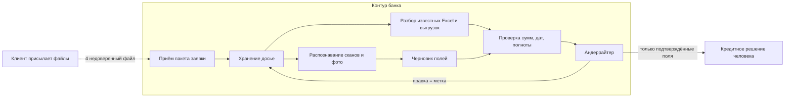
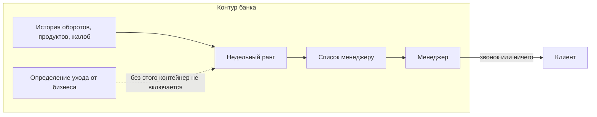

# C4 Container. Две остальные инициативы

## 18. Показатели из документов

Режим: асинхронно, пакет за пакетом. Кредитное решение не ждёт модель в ту же секунду. Если черновик не готов, человек разбирает пакет как сегодня. Это и есть фолбэк.

Модель — только распознавание и извлечение там, где шаблон не справился. Сходимость баланса и обязательность поля — обычный код. Человек подтверждает до того, как цифра попадёт в решение.

Внешнего поиска и инструментов у модели нет: всё нужное уже в пакете. Тащить «модель сходит в интернет проверить контрагента» в эту схему не за чем — это другая задача и другая граница.

Выход: поле, значение, файл, страница, уверенно прочтено или нет. Нет страницы-источника — поле в решение не идёт, даже если человек торопится. Это проверка до бизнес-действия.

## 8. Кто уйдёт

Режим: пакет раз в неделю. Клиент ничего не ждёт в реальном времени. Опоздавший пакет значит, что на неделе списка нет, а не что «все надёжные».

Модель только ранжирует. Письмо, скидка и тем более ограничение счёта — не её действие. База сравнения — простое правило, оно же фолбэк, если пакет не посчитался.

Граница доверия здесь внутренние: жалоба как признак. Наружу список не отправляется. Отдельный номер на схеме флагмана не вешаем, чтобы не смешивать документы. Для этой инициативы граница одна: текст жалобы входит в признак только после ответа DPO. До ответа признак — сам факт обращения, без текста.
