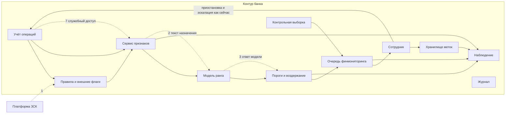
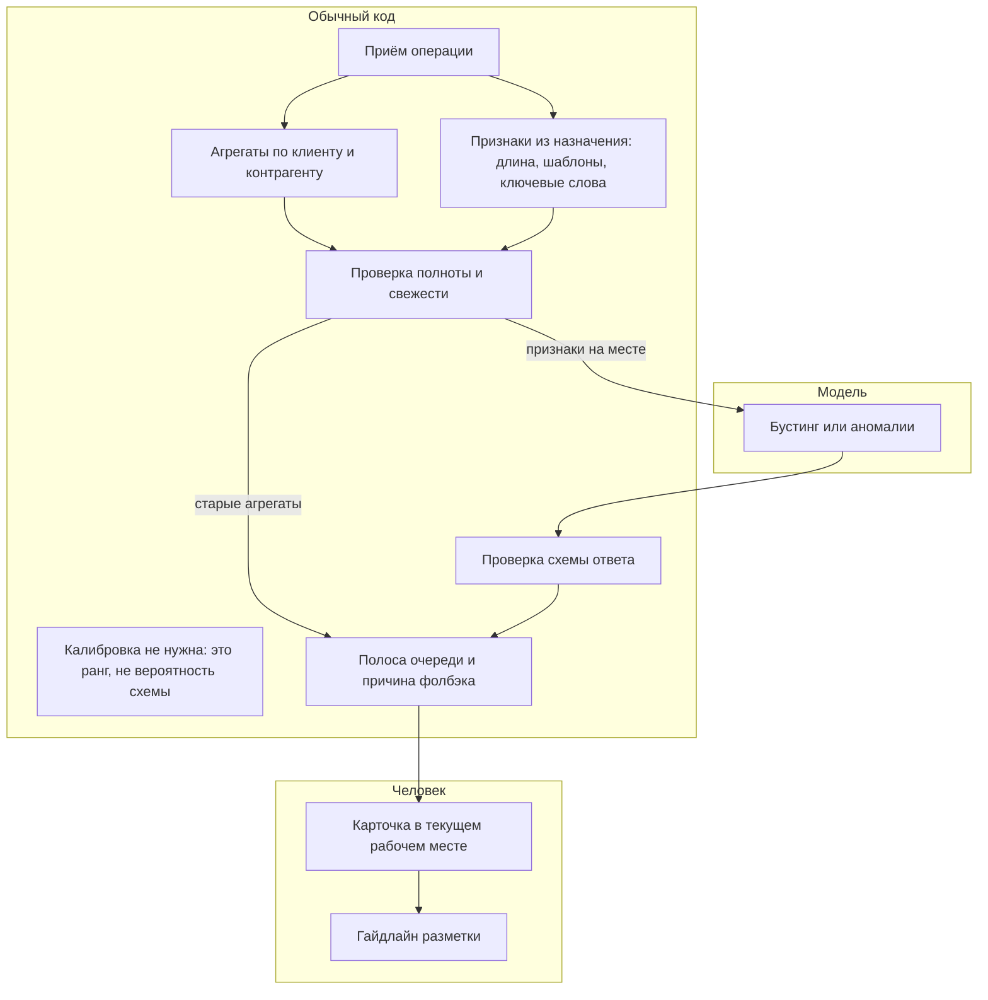

# C4. Флагман: очередь подозрительных операций

Сервис не ловит схему сам. Он меняет порядок очереди. Платёж из-за него не останавливается и не пропускается.

Режим: асинхронно. Операция проводится как сейчас. Ранг появляется рядом, обычно в пределах минут, и не держит платёж. Ночные агрегаты по клиенту считаются пакетом. Если пакет опоздал, дневной ранг помечается «признаки вчерашние» и может уйти в воздержание.

Человек уже есть в процессе: те же 25 сотрудников, та же процедура. Мы не ставим второго контура «на всякий случай» рядом.

## Уровень Container

Пунктир на схеме — граница доверия. 

Что снаружи контура на этой схеме одно: платформа «знай своего клиента», граница 1. Модель наружу не ходит. Отдельного вендора нет, поэтому границы «данные уехали к провайдеру» на целевой схеме нет. Если её когда-нибудь добавят, это новое решение, не стрелка по умолчанию.

## Уровень Component

Внутри контейнера «ранжирование» звенья такие. Лишнего нет: поиск по документам не нужен, языковая модель не нужна, инструменты у модели нет.

Где что:

| Звено | Кто | Зачем оно здесь |
|---|---|---|
| Приём, агрегаты, признаки текста, полнота | Обычный код | Считает то, что и так можно посчитать. Модель этому не учится |
| Бустинг или аномалии | Модель | Единственное место, где нужна закономерность по примерам |
| Полоса очереди, схема ответа | Обычный код | Решает, можно ли вообще менять порядок. Модель этого не решает |
| Очередь, карточка, гайдлайн | Человек в старом процессе | Эскалация и приостановка |
| Контрольная выборка | Обычный код, случайный отбор | Чтобы не размечать только то, что подняла модель |

Калибровку «вероятности схемы» не ставим: постановка не про вероятность схемы. Порог здесь — не «блокировать от 0,8», а полоса очереди: смотреть сейчас, смотреть сегодня, обычный порядок, воздержаться.

## Уровень автоматизации

| Действие | Кто |
|---|---|
| Пометить операцию правилом, как сегодня | Правила, без модели |
| Поставить ранг и объяснение | Модель, это рекомендация |
| Вставить контрольную операцию в очередь | Код, по расписанию |
| Эскалировать, приостановить, пропустить | Только человек |
| Поменять боевой порядок очереди | Только после критериев пилота, и всё равно без блокировки |

Цена ошибок связана с порогами так: голову очереди делаем короткой, чтобы человек успевал. Широкая «смотреть всё, что модель не любит» снова упрётся в 35 тысяч и в лишние приостановки. Поэтому автодействия нет, а полоса «смотреть сейчас» ограничена тем объёмом, который служба реально разбирает, — около 10 тысяч в месяц, не больше.
